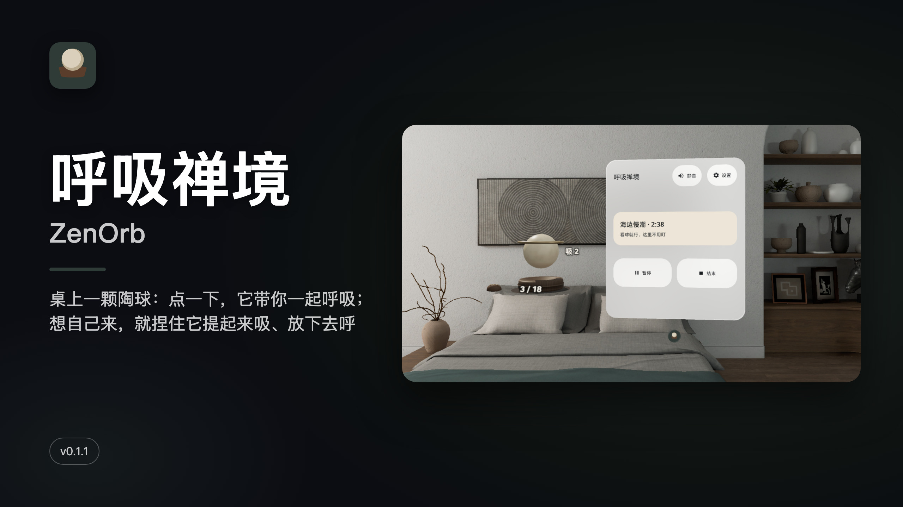
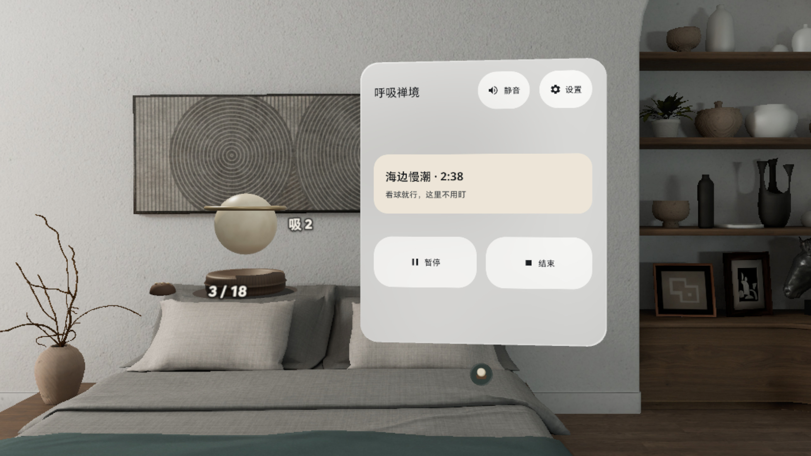
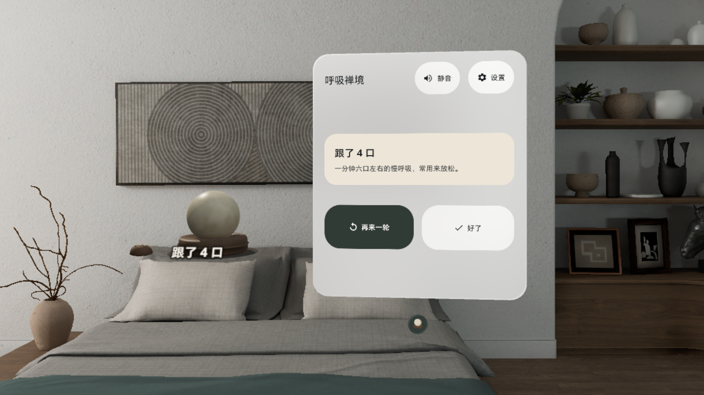
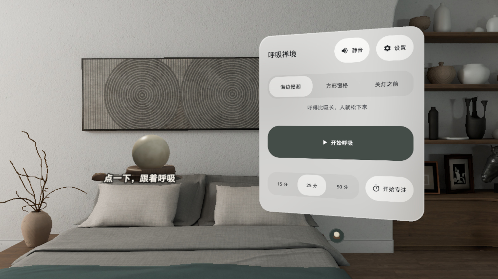
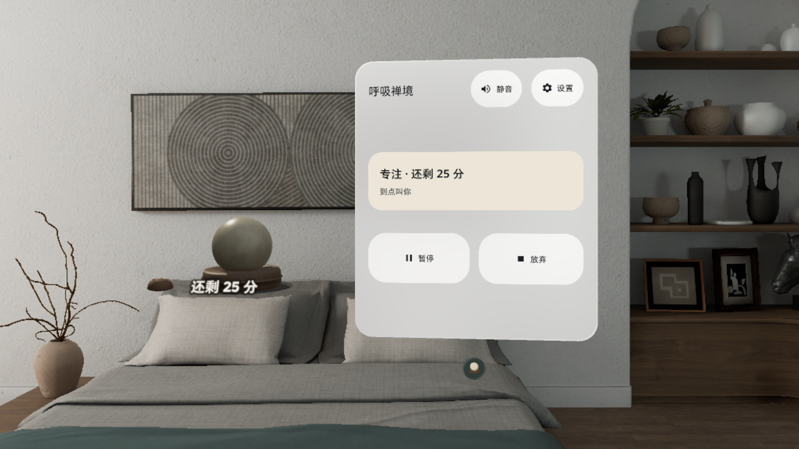
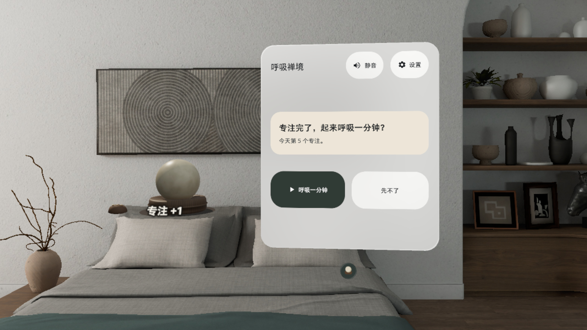
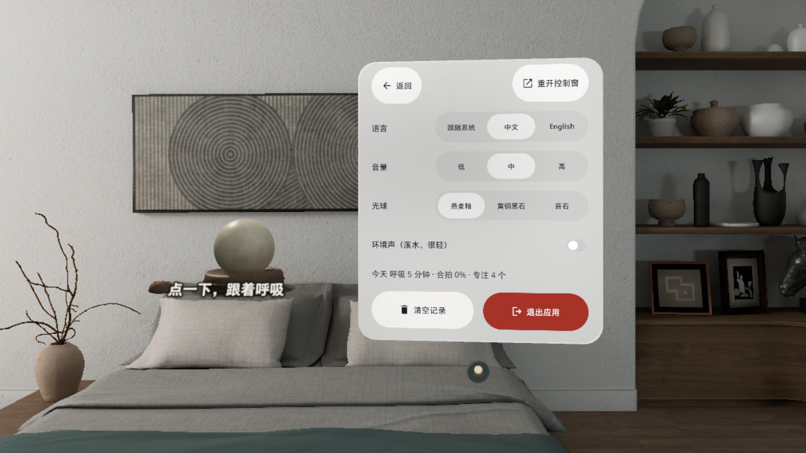
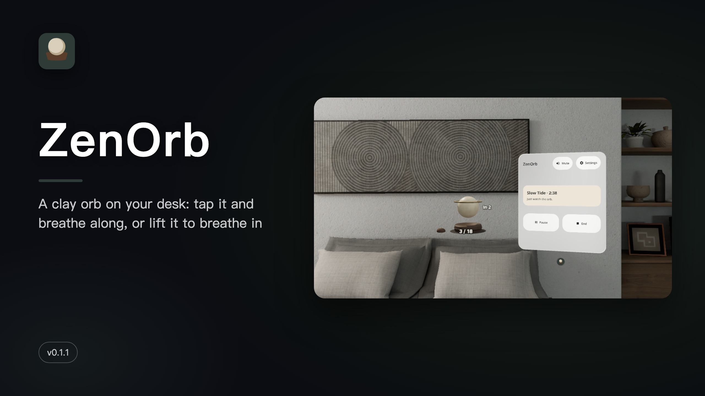

# 呼吸禅境 ZenOrb



[中文](#中文) · [English](#english)

## 中文

桌边放着一颗手作陶球，坐在胡桃木托上。工作间隙点它一下，它就自己慢慢升起、落下，带你吸、带你呼；想自己来，就隔空捏住它：往上提是吸，往下放是呼。PICO OS 6 共享空间（Shared Space）应用，全离线。

### 功能

- **三种节奏**：海边慢潮（吸 4 呼 6）、方形窗格（4-4-4-4）、关灯之前（4-7-8）
- **跟随**：点一下球，3 · 2 · 1 后球自己呼吸（升起时微微胀大、变亮），每口开头一声轻颂钵，不打分；再点一下暂停
- **跟拖**：捏住球上下拖，出现引导环，下一口起计合拍；一轮结束有一句小结
- **专注**：15 / 25 / 50 分钟，底座边一圈细弧随剩余时间变短；到点邀请你起来呼吸一分钟
- 控制窗在球右侧；关掉后点底座左前的小石子「⋯」叫回
- 三套球与底座（燕麦釉 · 胡桃 / 黄铜环 · 黑石 / 苔石 · 板岩），环境声溪水可选（默认关）
- 手势捏合、眼动注视 + 捏合、手柄射线；中英双语；不联网、无账号

### 截图

| | |
|---|---|
|  跟随：球自己呼吸，球旁「吸 2」、底座前「3 / 18」 |  一轮结束：「跟了 4 口」 |
|  选节奏、开始呼吸或专注 |  专注 25 分钟 |
|  专注完了，起来呼吸一分钟？ |  设置：语言、音量、球样式、环境声、今天 |

截图来自 PICO 模拟器（调试命令驱动到各状态）。Release 里的演示视频是模拟器录屏、调试输入驱动、无声，**非真实手势录像**。

### 安装

从 [Releases](https://github.com/kejing-dev/ZenOrb/releases) 下载 `ZenOrb-v0.1.1.apk`（assembleRelease 未签名包，供平台托管签名）。自己装到头显请用本地 debug 构建：

```bash
export JAVA_HOME=<JDK 17+>
./gradlew assembleDebug
adb install -r app/build/outputs/apk/debug/app-debug.apk
pico-cli app launch io.embodit.zenorb
```

要求：PICO OS 6（Android 15，minSdk 35），Spatial SDK 6.1.9。

### 构建与测试

```bash
./gradlew assembleDebug :app:testDebugUnitTest   # JVM 单测：合拍判定、曲线、流程、存档、布局、命中、对比度
./gradlew assembleRelease                         # 未签名 release 包
```

开发说明见 [AGENTS.md](AGENTS.md)，版本记录见 [CHANGELOG.md](CHANGELOG.md)。

### 素材

颂钵、溪水音效为 freesound CC0 录音；3D 球与底座为程序自建模型（`tools/build_models.py`）。

## English

A handmade clay orb sits in a walnut cradle beside your work. Tap it and it rises and settles on its own, breathing with you; or pinch it in the air: lift to breathe in, lower to breathe out. A PICO OS 6 Shared Space app, fully offline.

### Features

- **Three rhythms**: Slow Tide (in 4, out 6), Box (4-4-4-4), Lights Out (4-7-8)
- **Follow**: tap the orb, 3 · 2 · 1, and the orb breathes by itself (a little fuller and brighter as it rises), with a soft singing bowl at each phase; no score. Tap again to pause
- **Lead**: pinch and drag the orb; a guide ring appears and matched breaths are counted from the next breath; a one-line summary at the end
- **Focus**: 15 / 25 / 50 minutes; a thin arc round the cradle shrinks with the time left; at the end it invites you to breathe for a minute
- Control window to the right of the orb; closed it? Tap the small stone "⋯" at the cradle
- Three orb styles (Oat Glaze & Walnut / Brass Ring & Basalt / Moss Stone & Slate); optional creek ambience (off by default)
- Hand pinch, gaze + pinch, controller ray; Chinese and English; no network, no account



Screenshots are from the PICO emulator (states reached with debug commands). The demo video in the Release is an emulator recording driven by debug input, silent, **not a real hand-gesture recording**.

### Install

Download `ZenOrb-v0.1.1.apk` from [Releases](https://github.com/kejing-dev/ZenOrb/releases) (unsigned assembleRelease build, for platform-managed signing). To sideload to a headset, build debug locally:

```bash
./gradlew assembleDebug
adb install -r app/build/outputs/apk/debug/app-debug.apk
pico-cli app launch io.embodit.zenorb
```

Requires PICO OS 6 (Android 15, minSdk 35), Spatial SDK 6.1.9.

### Assets

Singing bowl and creek sounds are CC0 recordings from freesound; the 3D orb and cradle are procedurally built models (`tools/build_models.py`).
